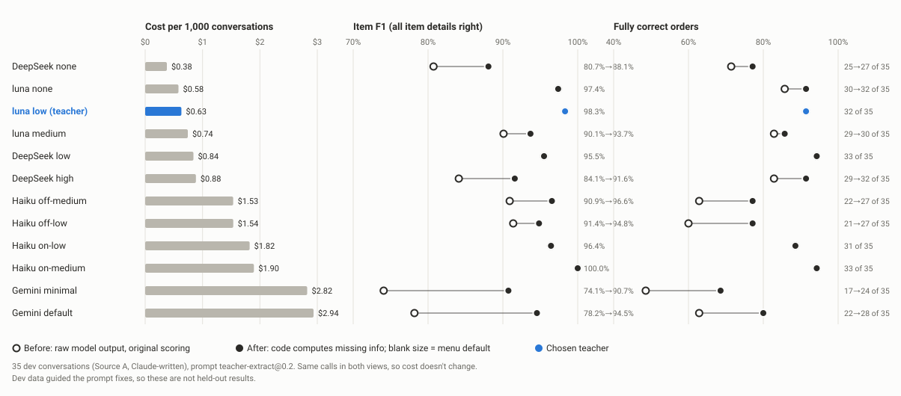

# Experiment 1: Teacher bake-off (M3)

**Decision (Julian, 2026-10-15): the teacher is `openai/gpt-6-luna` with reasoning effort `low`.** It tied the most
accurate setting (Claude Haiku 5.5, adaptive thinking at effort medium) on 86 dev chats at about a third of the cost,
and as a non-Claude model it isn't exposed to the bias of Claude-written evaluation data.

All numbers below come from saved run outputs in `runs/teacher-bakeoff/` and are regenerated by code:
`uv run python -m orderslm.eval.bakeoff_chart` writes `runs/teacher-bakeoff/chart-data.json` and the chart;
`make teacher-bakeoff ARGS=--summary` rebuilds `runs/teacher-bakeoff/summary.json` (every run, both views) for the
case study. **These are dev results that guided prompt and code fixes: tuning results, not held-out results.** The
sealed test split gives held-out numbers at the end of the project (spec §12).

## Setup

- **Data:** dev split, Source A (Claude-written from scenario cards, reviewed by Julian). A fixed, seeded 40-chat
  bake-off set (`eval/dataset.bakeoff_set`, seed 20261015, 28 with an order + 12 without, the dev ratio); the 51 other
  dev chats were held back for the head-to-head. Samples are never evaluated (the loader rejects `split: sample`).
- **Models and settings (12):** `gpt-6-luna` reasoning none / low / medium (default); `claude-haiku-5-5` thinking
  off or on × effort low or medium (on-medium is the default); `gemini-3.1-flash-lite` reasoning minimal / default;
  `deepseek-flash` reasoning none / low / high (default). Config: `config/models.json`.
- **Same input for every model:** one prompt (`src/orderslm/extractors/prompts/`, built from the annotation guide's
  gold rules), the menu as JSON, the chat with message indices. The output schema is sent as a constraint to luna and
  Gemini; Haiku and DeepSeek get it in the prompt only (Anthropic allows at most 16 nullable fields in a schema, ours
  has 24; DeepSeek has a JSON-object mode only). Full validation is always done in code.
- **Scoring** (`eval/metrics.py`): *item F1*, an item counts only if menu item, quantity, size and every modification
  match gold; *fully correct*, the whole order matches (items, pickup/delivery, time, address, payment, name,
  confirmation, what still needs asking); invalid JSON counts as missing every gold item.
- **Two views of the same answers:**
  - *Before*: the model's raw JSON, original scoring (an unstated size counts as different from the menu default).
  - *After*: the same JSON through `core/finalize.py`. Code fills an unstated default size ("2 cheeseburgers" =
    single), recomputes what's missing from the model's facts with the same rules as the gold labels, writes the
    question from a template, and turns "confirmed" with gaps into "pending, agreed while incomplete". Scoring treats
    a blank size and the menu default as equal. No new API calls, so cost is identical.
- **Cost:** recorded token usage × prices verified on the providers' pages (docs/COSTS.md), in integer micro-dollars.

## Results: all 12 settings (35 chats, prompt v0.2)

Bake-off positions 6–40 (the 5-chat pilot used positions 1–5). 58 gold items. Arrows show before → after; a single
value means the code rules didn't change it.

| Setting | Cost (35 chats) | Per 1,000 chats | Valid JSON | Items found / extra / missed (of 58) | Item F1 | Fully correct (of 35) | Tokens per chat in / out / reasoning |
|---|---|---|---|---|---|---|---|
| DeepSeek none | $0.0132 | $0.38 | 31 | 44/7/14 → 48/3/10 | 80.7% → 88.1% | 25 → 27 | 8.3K / 440 / 0 |
| luna none | $0.0203 | $0.58 | 34 | 56/1/2 | 97.4% | 30 → 32 | 9.8K / 371 / 0 |
| **luna low (teacher)** | $0.0221 | $0.63 | 35 | 58/2/0 | 98.3% | 32 | 9.8K / 473 / 115 |
| luna medium (default) | $0.0260 | $0.74 | 32 | 50/3/8 → 52/1/6 | 90.1% → 93.7% | 29 → 30 | 9.8K / 697 / 294 |
| DeepSeek low | $0.0294 | $0.84 | 33 | 53/0/5 | 95.5% | 33 | 8.4K / 1199 / 811 |
| DeepSeek high (default) | $0.0309 | $0.88 | 32 | 45/4/13 → 49/0/9 | 84.1% → 91.6% | 29 → 32 | 8.4K / 1271 / 894 |
| Haiku off-medium | $0.0537 | $1.53 | 28 → 31 | 50/2/8 → 56/2/2 | 90.9% → 96.6% | 22 → 27 | 12.3K / 610 / 0 |
| Haiku off-low | $0.0537 | $1.54 | 30 → 31 | 53/5/5 → 55/3/3 | 91.4% → 94.8% | 21 → 27 | 12.3K / 613 / 0 |
| Haiku on-low | $0.0637 | $1.82 | 32 | 54/0/4 | 96.4% | 31 | 12.3K / 1182 / 599 |
| Haiku on-medium (default) | $0.0663 | $1.90 | 34 | 58/0/0 | 100.0% | 33 | 12.3K / 1332 / 745 |
| Gemini minimal | $0.0989 | $2.82 | 27 | 40/10/18 → 49/1/9 | 74.1% → 90.7% | 17 → 24 | 8.1K / 531 / 0 |
| Gemini default | $0.1027 | $2.94 | 30 | 43/9/15 → 52/0/6 | 78.2% → 94.5% | 22 → 28 | 8.1K / 605 / 0 |

- **More reasoning wasn't better.** luna medium and DeepSeek high scored below their `low` setting, mostly through
  invalid outputs (a "pending" decision citing evidence, a size on an off-menu line).
- **The code rules help most where models misapplied rules they had the facts for**: Gemini (+6 to +7 fully correct),
  Haiku with thinking off (+5 to +6), and a cheeseburger with no size filled with the default.
- **Statistical caution:** with 35 chats the 95% intervals for fully correct overlap for the top settings
  (e.g. 33/35 is 81–98%, 32/35 is 78–97%). Cost differences are real; small accuracy differences among the top
  four may not be.
- **Selection rule (spec §8):** the cheapest setting within 3 points of the best item F1 is luna none (97.4% vs
  100%). Julian chose luna low instead: no invalid outputs and two more fully correct orders on this run, for
  5 cents more per 1,000 chats.

## Head-to-head: luna low vs Haiku on-medium (51 more chats)

The 51 dev chats outside the bake-off set (36 with an order, 79 gold items), prompt v0.2.

| Setting | Run cost | Per 1,000 chats | Valid JSON | Items found / extra / missed (of 79) | Item F1 | Fully correct (of 51) |
|---|---|---|---|---|---|---|
| **luna low** | $0.0292 | $0.57 | 51 | 79/2/0 | 98.8% | 48 → 50 |
| Haiku on-medium | $0.0933 | $1.83 | 49 | 79/2/0 | 98.8% | 47 → 48 |

Accuracy tied; luna is 3.2× cheaper. It used about a tenth of Haiku's reasoning tokens and got OpenAI's automatic
prompt caching (340K of 491K input tokens at the cached rate); Haiku got none (Anthropic caches only on request,
which the client doesn't do) and counts the same prompt as about 25% more tokens.

**Every extra item, both models, was in a chat with no new order.** luna: a complaint about a missing croissant
(a-dev-044), a catering request asking for a manager (a-dev-021, "30 large pizzas"), and an order already placed by
phone (a-dev-056, latte + croissant). Haiku: the same a-dev-056. Neither added anything in a real ordering chat.

## The chosen teacher on all 91 dev chats

luna low after two prompt fixes, then a repeat of the same run with the cache off to measure run-to-run variation.
146 gold items.

| luna low run | Run cost | Valid JSON | Items found / extra / missed (of 146) | Item F1 | Fully correct (of 91) |
|---|---|---|---|---|---|
| prompt v0.3 | $0.0544 | 88 | 137/1/9 → 138/0/8 | 96.5% → 97.2% | 85 → 87 |
| prompt v0.4, run 1 | $0.0547 | 91 | 143/3/3 → 146/0/0 | 97.9% → 100.0% | 83 → 90 |
| prompt v0.4, run 2 (repeat) | $0.0547 | 91 | 146/0/0 | 100.0% | 88 → 90 |

- **v0.3** ("items about a past or already-placed order, or a request to talk to someone, are not a new order")
  removed all four extras. Three confirm-then-change chats (a-dev-023/059/064) became invalid: luna cited the change
  as evidence on a plain "pending" decision, an error other luna settings had made earlier too.
- **v0.4** ("a plain pending has an empty evidence list") fixed those three.
- **Run-to-run variation:** the two identical v0.4 runs differ in 3 of 91 chats on raw output (never in items) and in
  1 of 91 after the code rules (a no-order complaint, where only an unused field differs). The one chat still not
  fully correct after the code rules, a-dev-049, is a shake flavor gold calls *ambiguous* and luna calls *missing*;
  the customer gets the same question either way.

## Provider findings

- **Anthropic:** a JSON schema may have at most 16 nullable (union-typed) fields; the order schema has 24, so every
  Haiku call in the first pilot was rejected (HTTP 400, not billed). Haiku 5.5 has effort levels low…max and adaptive
  thinking on by default; on easy prompts it often skips thinking.
- **OpenAI:** `reasoning_effort` none…max on Chat Completions; automatic prompt caching; usage also reports
  `cache_write_tokens` (whether writes are billed is still to check before bulk labeling).
- **Gemini:** the default reasoning level for 3.1 Flash-Lite behaved like `minimal` (no reasoning tokens reported).
  Implicit caching applied to up to 8.3K of 9.9K input tokens; Google says the savings are passed on but not at what
  rate, so our Gemini costs bill those tokens at the full $0.25/M and may be overstated (cached price $0.025/M).
- **DeepSeek:** JSON-object mode only; thinking on at effort `high` by default; peak/off-peak prices (all runs were
  off-peak).
- **Tokenizers differ:** the same prompt is 8.1K (Gemini) to 12.3K (Haiku) input tokens.

## Costs

| Run | What | Cost |
|---|---|---|
| Smoke tests (3) | one tiny call per setting | $0.0007 |
| Pilot (2 runs) | 5 chats × 12 settings, incl. the Haiku retry | $0.0968 |
| Bake-off | 35 chats × 12 settings | $0.5811 |
| Head-to-head | 51 chats × 2 settings | $0.1225 |
| luna on all dev (3 runs) | prompt v0.3, v0.4, repeat | $0.1637 |
| **M3 total** | | **$0.9648** |

## Limits

- Dev data guided the prompt and code fixes, so these are tuning results; held-out numbers come from the sealed test.
- Source A is Claude-written, which may favor Claude models; the teacher is not a Claude model.
- 35–91 chats per comparison: enough to separate the weak settings, not to rank the top few with confidence.
- One prompt (v0.2) for the 12-way comparison; only luna was re-run with v0.3/v0.4.

## For M4

Label through `core/finalize.py`; store chats with no items as "no order" (null), as gold does; have the decision
providers' label audit (spec §11d) check "new order or past order"; check whether OpenAI bills cache writes; use the
OpenAI Batch API (half price) for bulk labeling.
